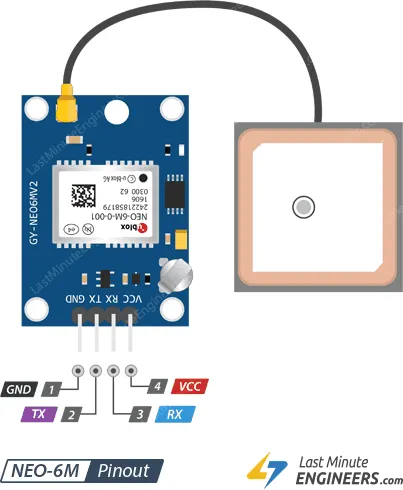
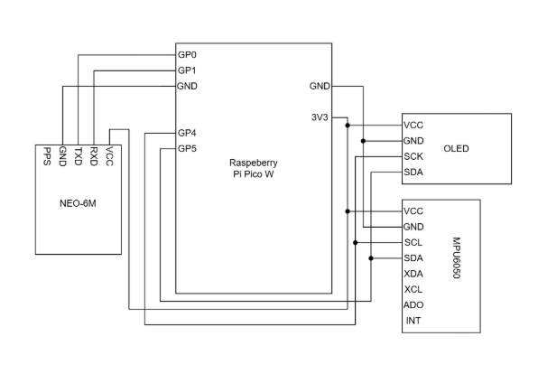
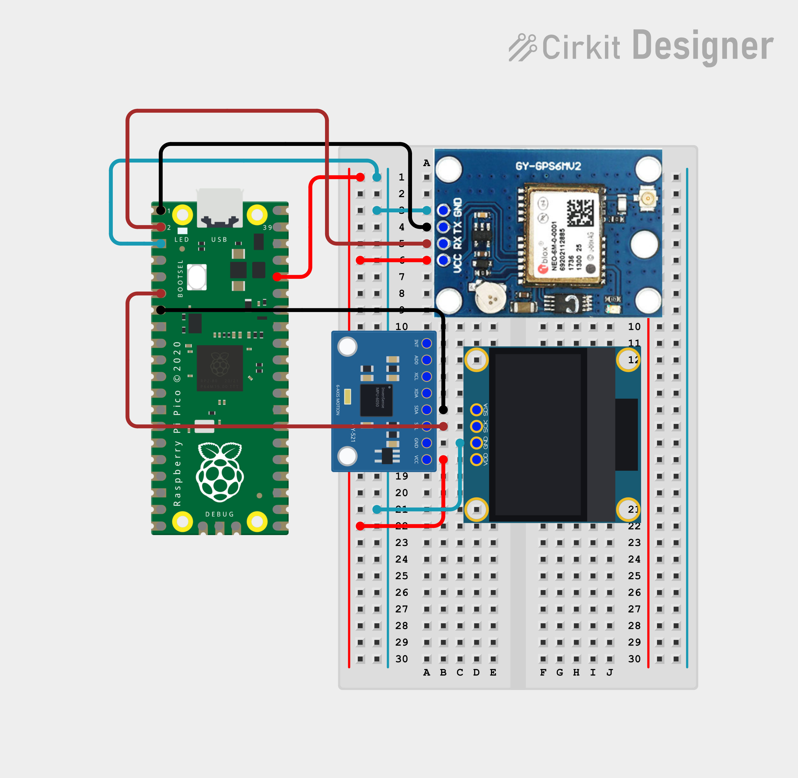
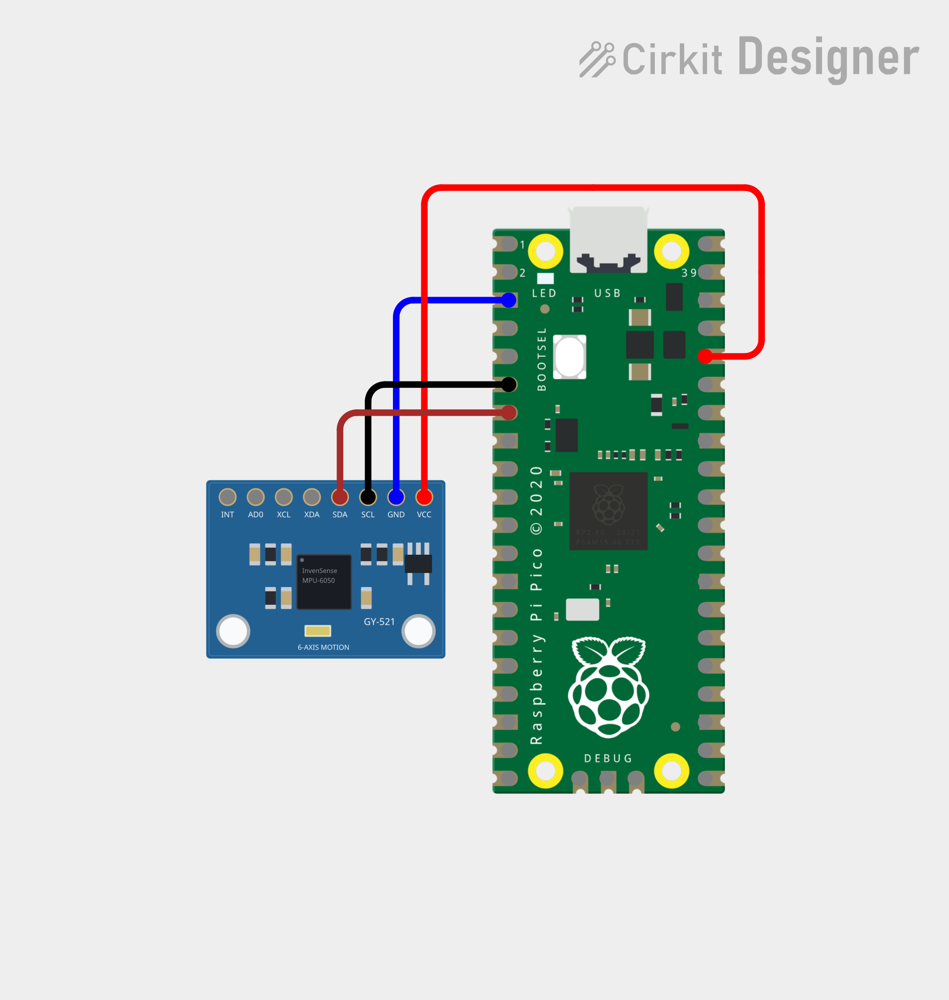

# GPS and IMU sensor unit

<h1>Úvod</h1>

Projekt GPS and IMU sensor unit je zameraný na vytvorenie senzorovej jednotky
pomocou mikropočítača Raspberry Pi Pico. Jednotka pozostáva z GPS modulu
NEO-6M, senzora MPU6050 a OLED displeja s rozlíšením 128x64. Cieľom projektu 
je získavať údaje o polohe a pohybe zariadenia, spracovať ich pomocou mikropočítača 
a zobrazovať namerané hodnoty na OLED displeji

<h2> Funkcia projektu </h2>

<ul>
    <li>meranie uhlovej rýchlosti pomocou gyroskopu,</li>
    <li>meranie zrýchlenia pomocou akcelerometra,</li>
    <li>získavanie údajov z GPS modulu NEO-6M,</li>
    <li>zobrazenie GPS fixu a dostupnosti GPS signálu,</li>
    <li>zobrazenie vybraných GPS údajov, napríklad rýchlosti alebo polohy,</li>
    <li>zobrazenie hodnôt gyroskopu a akcelerometra,</li>
    <li>zobrazenie výsledných údajov na OLED displeji.</li>
</ul>

<h1> Použitý software </h1>

<ul>
    <li> Programovací jazyk - MicroPython </li>
    <li> Použité knižnice -  </li>
    <li> Programovacie prostredie - Thonny, VSC </li>
</ul>

<h1> Použité moduly </h1>

<h2>MPU6050</h2>

<ul>
    <li> senzor obsahujúci 3-osový gyroskop a 3-osový akcelerometer </li>
    <li> senzor zodpovedný za meranie zrýchlenia (akcelerometer) a uhlovú rýchlosť (gyroskop) v troch rozmeroch </li>
</ul>

<h3> Použité vstupy/výstupy </h3>
<table>
<tr>
    <th>IN</th>
    <th>3V3</th>
  </tr>
  <tr>
    <th>GND</th>
    <th>GND</th>
  </tr>
  <tr>
    <th>OUT</th>
    <th>SCL</th>
  </tr>
   <tr>
    <th>OUT</th>
    <th>SDA</th>
  </tr>
</table>

<h2>NEO-6M</h2>

<ul>
    <li> NEO-6M je jednoduchý GPS prijímač </li>
    <li> slúži na získavanie údajov o polohe, rýchlosti a stave GPS signálu </li>
</ul> 

<h3> Použité vstupy/výstupy </h3>
<table>
<tr>
    <th>IN</th>
    <th>3V3</th>
  </tr>
  <tr>
    <th>GND</th>
    <th>GND</th>
  </tr>
  <tr>
    <th>IN</th>
    <th>RX</th>
  </tr>
  <tr>
    <th>OUT</th>
    <th>TX</th>
  </tr>
</table>

<h2> OLED displej </h2>

<ul>
    <li> OLED displej veľkosti 128x64 </li>
    <li> zobrazovanie údajov získaných z jednotlivých modulov </li>
</ul> 
  
  <h3> Použité vstupy/výstupy </h3>
<table>
<tr>
    <th>IN</th>
    <th>3V3</th>
  </tr>
  <tr>
    <th>GND</th>
    <th>GND</th>
  </tr>
  <tr>
    <th>OUT</th>
    <th>SCL</th>
  </tr>
   <tr>
    <th>OUT</th>
    <th>SDA</th>
  </tr>
</table>

<h1> Progres projektu </h1>

<h2> 1.týždeň </h2>

 rozdelenie úloh medzi členov tímu, kontrola hardvéru, vytvorenie blokového schéma a schéma zapojenia

<h3> Rozdelenie úloh </h3>
<ul>
    <li>Jozek - Gyroskop</li>
    <li>Kancian - Akcelerátor</li>
    <li>Nádvorník - GPS modul NEO-6M</li>
</ul>

<h3> Blokové schéma - koncept </h3>

<h3> Schéma zapojenia - koncept </h3>

<h2> 2.týždeň </h2>

<ul>
    <li> vytvorenie classov pre jednotlivé moduly </li>
    <li> realizácia zapojenia modulu a zobrazenie jeho výstupných hodnôt </li>
</ul>

<h3> MPU6050 </h3>

 Zapojenie pre testovanie 

<table>
<tr>
    <th>3V3</th>
    <th>PIN36</th>
  </tr>
  <tr>
    <th>GND</th>
    <th>GND</th>
  </tr>
  <tr>
    <th>SCL</th>
    <th>GP4</th>
  </tr>
   <tr>
    <th>SDA</th>
    <th>GP5</th>
  </tr>
</table>

<h4> Akcelerometer </h4>

 odkaz na kód pre modul akcelereometru:  <a href="codes/MPU_acc.py">MPU_acc</a> 

<h4> Gyroskop </h4>

 odkaz na kód pre modul gyroskopu: <a href="codes/MPU_gyro.py">MPU_gyro</a> 

<h3> GPS modul NEO-6M </h3>

*Diagram zapojenia pre zistenie meraných hodnôt/výstupné parametre*

*Tabuľka pre zapojenie modulu na mikropočítač*

<table>
<tr>
    <th>IN</th>
    <th>3v3</th>
  </tr>
  <tr>
    <th>GND</th>
    <th>GND</th>
  </tr>
  <tr>
    <th>OUT</th>
    <th>SCL</th>
  </tr>
   <tr>
    <th>OUT</th>
    <th>SDA</th>
  </tr>
</table>
  

