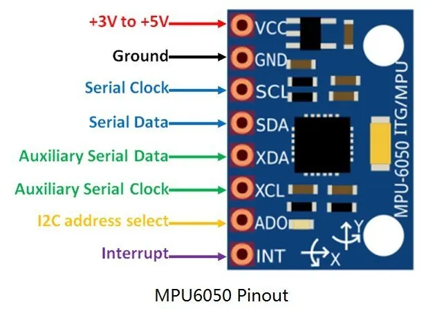
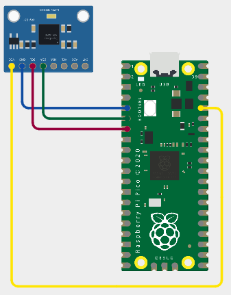

# GPS and IMU sensor unit

<h1>Úvod</h1>

Projekt GPS and IMU sensor unit je zameraný na vytvorenie senzorovej jednotky
pomocou mikropočítača Raspberry Pi Pico. Jednotka pozostáva z GPS modulu
NEO-6M, senzora MPU6050 a OLED displeja s rozlíšením 128x64. Cieľom projektu 
je získavať údaje o polohe a pohybe zariadenia, spracovať ich pomocou mikropočítača 
a zobrazovať namerané hodnoty na OLED displeji

<h2> Funkcia projektu </h2>

<ul>
    <li>meranie uhlovej rýchlosti pomocou gyroskopu,</li>
    <li>meranie zrýchlenia pomocou akcelerometra,</li>
    <li>získavanie údajov z GPS modulu NEO-6M,</li>
    <li>zobrazenie GPS fixu a dostupnosti GPS signálu,</li>
    <li>zobrazenie vybraných GPS údajov, napríklad rýchlosti alebo polohy,</li>
    <li>zobrazenie hodnôt gyroskopu a akcelerometra,</li>
    <li>zobrazenie výsledných údajov na OLED displeji.</li>
</ul>

<h1> Použité moduly </h1>

<h2>MPU6050</h2>

 
Senzor obsahujúci 3-osový gyroskop a 3-osový akcelerometer.
Senzor zodpovedný za meranie zrýchlenia (Akcelerometer) a uhlovú rýchlosť (Gyroskop) v troch rozmeroch

<h3>Vstúpy/Výstupy</h3>
<table>
<tr>
    <th>IN</th>
    <th>3v3</th>
  </tr>
  <tr>
    <th>GND</th>
    <th>GND</th>
  </tr>
  <tr>
    <th>OUT</th>
    <th>SCL</th>
  </tr>
   <tr>
    <th>OUT</th>
    <th>SDA</th>
  </tr>
</table>

<h2>NEO-6M</h2>

 NEO-6M je jednoduchý GPS prijímač, slúži na získavanie údajov o polohe,
rýchlosti a stave GPS signálu.

<h3>Vstúpy/Výstupy</h3>
<table>
<tr>
    <th>IN</th>
    <th>3v3</th>
  </tr>
  <tr>
    <th>GND</th>
    <th>GND</th>
  </tr>
  <tr>
    <th>IN</th>
    <th>Rx</th>
  </tr>
  <tr>
    <th>OUT</th>
    <th>Tx</th>
  </tr>
</table>

<h1>1.týždeň</h1>

rodelenie úloh kontrola hardvéru

<h2>Rozdelenie úloh</h2>
<ol></ol>
    <li>Jozek - Gyroskop</li>
    <li>Kancian - Akcelerátor</li>
    <li>Nádvorník - GPS modul NEO-6M</li>
</ol>

  <h2>OLED</h2>
  
OLED displej veĽkosti 128x64

  <h3>Vstúpy/Výstupy</h3>
<table>
<tr>
    <th>IN</th>
    <th>3v3</th>
  </tr>
  <tr>
    <th>GND</th>
    <th>GND</th>
  </tr>
  <tr>
    <th>OUT</th>
    <th>SCL</th>
  </tr>
   <tr>
    <th>OUT</th>
    <th>SDA</th>
  </tr>
</table>
  <h2>Akcelerometer</h2>
  
*Diagram zapojenia pre zistenie meraných hodnôt/výstupné parametre*

  
  
 
  
*Tabuľka pre zapojenie modulu na mikropočítač*

<table>
<tr>
    <th>3v3</th>
    <th>PIN36</th>
  </tr>
  <tr>
    <th>GND</th>
    <th>PIN3</th>
  </tr>
  <tr>
    <th>SCL</th>
    <th>GP3</th>
  </tr>
   <tr>
    <th>SDA</th>
    <th>GP2</th>
  </tr>
</table>
  <h2>Gyroskop</h2>
  
*Diagram zapojenia pre zistenie meraných hodnôt/výstupné parametre*

  
Zapojenie pinov

<table>
<tr>
    <th>3v3</th>
    <th>PIN36</th>
  </tr>
  <tr>
    <th>GND</th>
    <th>PIN3</th>
  </tr>
  <tr>
    <th>SCL</th>
    <th>GP3</th>
  </tr>
   <tr>
    <th>SDA</th>
    <th>GP2</th>
  </tr>
</table>

 - gyroskop spolu s akcelerometrom tvoria modul MPU6050, preto budú mať rovnaké zapojenie pinov 

 - gyroskop meria uhlovú rýchlosť v °/S priestorových osí (X,Y,Z) 

  <h2>GPS modul NEO-6M</h2>
  
*Diagram zapojenia pre zistenie meraných hodnôt/výstupné parametre*

  
*Tabuľka pre zapojenie modulu na mikropočítač*

<table>
<tr>
    <th>IN</th>
    <th>3v3</th>
  </tr>
  <tr>
    <th>GND</th>
    <th>GND</th>
  </tr>
  <tr>
    <th>OUT</th>
    <th>SCL</th>
  </tr>
   <tr>
    <th>OUT</th>
    <th>SDA</th>
  </tr>
</table>
  <h1>2.týždeň</h1>
  
realizácia zapojenia a program pre zobrazenie výstupných hodnôt jednotlivých modulov

  <h2>Rozdelenie úloh</h2>
  <h2>Spojenie individualných modulov</h2>
  
*Diagram kompletného zapojenia*

